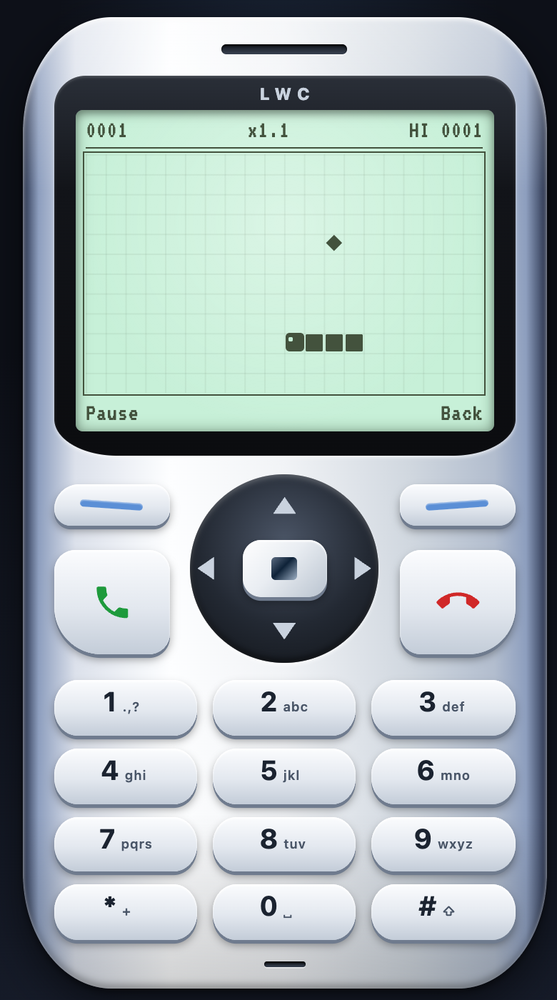

# 🐍 LWC OSS Snake Game

[](https://github.com/svierk/lwc-oss-snake-game/actions/workflows/ci.yml)

The project was born out of pure interest in using Lightning Web Components outside of the Salesforce platform.
I was inspired to the Snake idea by the following blog article, which the first version of the game was based on:

[How to Build the Snake Game Using Lightning Web Components](https://developer.salesforce.com/blogs/2020/09/how-to-build-the-snake-game-using-lightning-web-components)

If you are also interested in LWC OSS you can find more info here: https://lwc.dev/

Play it live: https://lwc-oss-snake-game.vercel.app/

## Preview



The retro phone is built entirely with HTML and CSS - no images. It scales with the viewport and switches to a
landscape layout (screen left, keys right) when a phone is held sideways.

## Controls

| Action        | Phone                        | Keyboard                               | Touch               |
| ------------- | ---------------------------- | -------------------------------------- | ------------------- |
| Steer         | `2` `4` `6` `8` or the d-pad | Arrow keys, `W A S D`, `2` `4` `6` `8` | Swipe on the screen |
| Start / pause | `5`, select, call, left soft | `Enter`, `Space`, `P`, `5`             | Tap on the screen   |
| Back          | End, right soft key          | `Escape`, `Backspace`                  |                     |

Steering on the start screen starts the game right away. _Back_ pauses a running game; pressed again it returns to the
start screen. Keys pressed on the keyboard light up on the phone as well.

The snake wraps around the edges of the screen and gets faster with every piece of food it eats. The game pauses
automatically when the browser tab is hidden. The high score is kept in the browser's local storage.

## Project Setup

The directory structure looks like this:

```
src/
  ├── assets/              // static assets (favicon, VT323 pixel font)
  ├── layouts/
  │   └── main.html        // html document, global styles and @font-face
  └── modules/snake/
      ├── app/             // root component: wires keyboard + phone keys to the game
      ├── embedding/       // bridge to a Salesforce page that frames the game (no LWC)
      ├── engine/          // pure game logic (no DOM, no timers) - easy to unit test
      ├── game/            // the LCD: game loop, rendering, swipe input, high score
      └── phone/           // the retro phone hardware: body, bezel and keys
lwr.config.json            // lwr configuration
package.json               // npm packaging configuration
```

The components only talk to each other in one direction:

```
keyboard ─┐
          ├─► snake-app ──press(action)──► snake-game ──► snake/engine
phone key ┘   (key → action mapping)       (LCD)          (rules)
```

`snake-phone` knows nothing about Snake - it renders whatever is slotted into its screen and reports every key as a
`phonekey` event; its `active-key` attribute highlights a key while the matching keyboard key is held. Swipes and
taps on the screen are handled by `snake-game` itself. `snake-game` exposes a single `press(action)` method with the actions `up`, `down`, `left`, `right`,
`select` and `back`. All rules live in `snake/engine` as pure functions that turn one state into the next.

## Configuration

The LWR server is configured in `lwr.config.json`, at the root of the project. It has one LWC module directory and one
server-side route. The components use native shadow DOM.

```json
{
  "lwc": { "modules": [{ "dir": "$rootDir/src/modules" }] },
  "routes": [
    {
      "id": "snake",
      "path": "/",
      "rootComponent": "snake/app",
      "layoutTemplate": "$layoutsDir/main.html"
    }
  ],
  "assets": [
    {
      "alias": "assetsDir",
      "dir": "$rootDir/src/assets",
      "urlPath": "/assets"
    },
    {
      "alias": "favicon",
      "file": "$rootDir/src/assets/favicon.ico",
      "urlPath": "/favicon.ico"
    }
  ]
}
```

## Embedding in Salesforce

The game can run as an externally hosted microfrontend on a Lightning page: a host LWC frames it with
`<lightning-ui-embedding>`. The [Polyglot Arcade](https://github.com/svierk/polyglot-arcade) does that with this
Vercel deployment and saves every finished round as a score record.

LWR cannot resolve the `@salesforce/platform-sdk` package, so `snake/embedding` implements the guest side of the
[package-free bridge](https://developer.salesforce.com/docs/platform/microfrontend/guide/package-free-bridge.html)
directly. It only becomes active when the page is framed and its URL carries the `hostMetaData` parameter that
`<lightning-ui-embedding>` appends - opened on its own, the game behaves exactly as before.

```
host LWC (Salesforce)                         Snake (this site, in an iframe)
    │  iframe src ...?hostMetaData={hostAppOrigin, instanceId}
    │ ◄──────────────────── sf-embedding/ready (window message to hostAppOrigin only)
    │ ── sf-embedding.bootstrap + MessagePort ────────► checked: origin, parent, instanceId, one port
    │                       JSON-RPC 2.0 over the port
    │ ── ui/notifications/host-initialized ───────────►
    │ ◄──────────────── ui/notifications/embedding-initialized
    │ ◄──────────────── ui/subscribe/ui-state            (host props, unused by the game so far)
    │ ◄──────────────── ui/notifications/resize          (height of the game)
    │ ◄──────────────── ui/events/dispatch  gameover
```

When a round ends (game over or won) the game sends a `gameover` event to the host:

```js
{ gameKey: 'snake', gameName: 'Snake', score: 12, level: 3, durationSeconds: 41 }
```

`level` goes up every five pieces of food (each half step of speed), `durationSeconds` counts the time played without
pauses. The game has no Salesforce session of its own - saving the score is up to the host.

Embedded, the phone is sized by the width of the frame and the landscape layout is not used: the host sets the height
of the frame from the reported height of the game, so a size that follows the frame's height would never grow.

To embed the game in your own org:

- Add `https://lwc-oss-snake-game.vercel.app` as a CSP Trusted Site with the _frame-src_ directive. Vercel sends no
  `X-Frame-Options` or `frame-ancestors` header, so the page may be framed.
- Point the `src` of `<lightning-ui-embedding>` at the site root and handle the event declaratively, e.g.
  `<lightning-ui-embedding src={snakeUrl} ongameover={handleGameOver}>`.
- To test changes before they are deployed, run `yarn dev`, trust `http://localhost:3000` the same way and point the
  host at it. Chrome's Local Network Access checks can block a public site from framing `localhost`; if the frame
  stays empty, allow local network access for the org's domain in the site settings.

## Running Linter, Prettier and Tests

Run _Prettier_ to check all files for formatting issues:

```
yarn run prettier
```

Run _ESLint_ to check for linting issues:

```
yarn run lint
```

Run the _Jest_ unit tests (add `:coverage` for a coverage report):

```
yarn run test:unit
```

## Running the Project in Dev Mode

Requirements: Node.js 24 and Yarn 4 (the exact version is pinned in `package.json#packageManager` - run
`corepack enable` once to use it).

Install all required dependencies:

```
yarn install
```

Start the local development server:

```
yarn dev
```

Open the site at [http://localhost:3000](http://localhost:3000)

## Statically Generate and Preview the Site

Build the project into the `site` directory (it is not committed - Vercel builds it on every deployment):

```
yarn build
```

Preview the generated site:

```
yarn start
```

Open the site at [http://localhost:3000](http://localhost:3000)

## Credits

The LCD uses the [VT323](https://fonts.google.com/specimen/VT323) font by Peter Hull, licensed under the
[SIL Open Font License](./src/assets/fonts/OFL.txt). It is served from this site, not from a third-party CDN.
